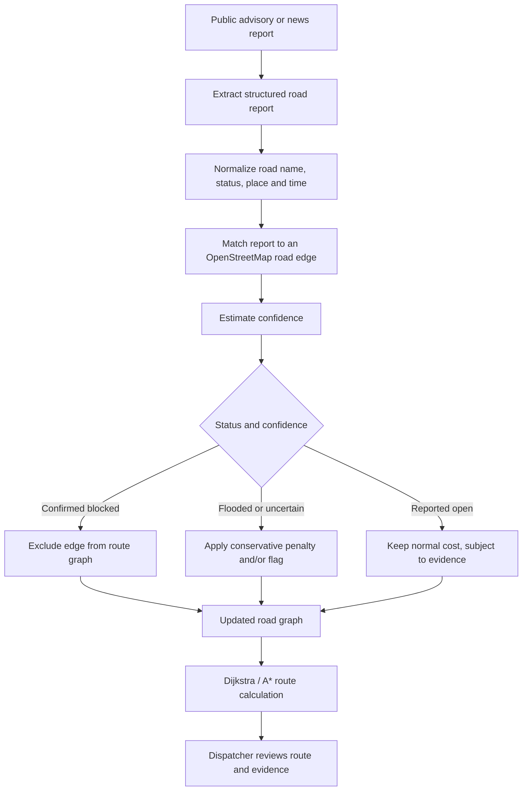
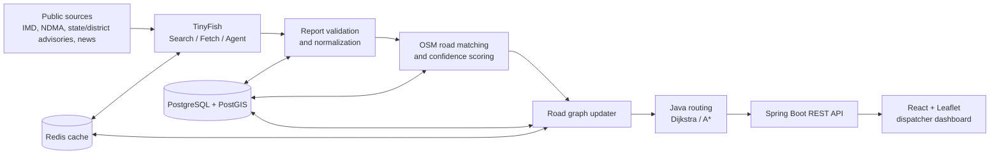

# ResQ-Route

**AI-powered disaster logistics: turning live web-based road intelligence into safer relief routes.**
ResQ-Route is a proposed disaster-logistics platform designed to help relief dispatchers understand which roads may be open, flooded, or blocked during floods. It aims to combine public advisories and news with OpenStreetMap road data, route planning, and a human approval workflow.
**Project status:** Prototype development has not started yet. This README describes the proposed design and planned implementation. The live data pipeline, road matching, routing engine, and dashboard are **not implemented or validated yet**. Any sample route values mentioned in the proposal are illustrative, not live results.

---

## Table of Contents

1. [The Problem](#the-problem)
2. [Proposed Solution](#proposed-solution)
3. [Technical Differentiator](#technical-differentiator)
4. [Planned Architecture](#planned-architecture)
5. [Planned Tech Stack](#planned-tech-stack)
6. [Illustrative User Journey](#illustrative-user-journey)
7. [Implementation Status](#implementation-status)
8. [Evaluation Plan](#evaluation-plan)
9. [Risks and Mitigations](#risks-and-mitigations)
10. [Roadmap](#roadmap)
11. [Setup](#setup)
12. [Sources and References](#sources-and-references)
13. [Team](#team)

---

## The Problem

During floods, road conditions can change quickly, while information about closures and passable routes may be scattered across advisories, news reports, and local updates. Relief teams need to know which roads may be unsafe before dispatching supplies.
The original project proposal highlights the following context:

| Figure | What it refers to | Reference |
|---|---|---|
| ~1,600 | Average annual flood-related deaths in India, as cited in the proposal | NDMA website; exact underlying report should be verified before final submission |
| ~14% | 46 million of India's 329 million hectares described as flood-prone | [Down To Earth article](https://www.downtoearth.org.in/amp/story/water/why-do-floods-droughts-simultaneously-ravage-india-expert-offers-explanation-solutions-95705) |
| 3.86 million | New disaster-related displacements in India in 2020; this covers **all disaster hazards**, not floods alone | [Researching Internal Displacement review](https://researchinginternaldisplacement.org/short_pieces/disaster-induced-internal-displacement-in-india-in-2020-a-review/) |

The proposal also cites the June 2013 Uttarakhand floods as an example of severe road disruption and people stranded. The exact source for the specific figures should be checked and linked before making a final public submission.

### Why existing approaches may leave a gap
| Approach | What it does well | Potential gap for relief logistics |
|---|---|---|
| Phone calls and messages to field officers | Can provide trusted local information | Information can be fragmented and difficult to view on one shared map |
| Official alerts and advisories | Provide important hazard warnings | Road-specific details may be spread across different pages and formats |
| Everyday navigation apps | Provide convenient routing for normal travel | May not provide a relief-focused workflow with road-status evidence and dispatcher approval |

This is a proposed problem framing, not a claim that existing tools are ineffective in every situation. It should be validated with disaster-management practitioners.

---

## Proposed Solution
ResQ-Route is planned around four stages:

1. **Sense:** Use TinyFish to search public sources and retrieve relevant advisories, news, or road-closure reports.
2. **Match:** Extract a structured road report and attempt to match it to the correct road or edge in an OpenStreetMap road graph.
3. **Route:** Update the graph using the report status and confidence, then use a Java routing engine to calculate a route and alternatives.
4. **Review and approve:** Show the proposed route, ETA, evidence, timestamps, and uncertainty to a dispatcher. A human makes the final decision.

The system is intended to support decisions, **not to guarantee that a route is safe** or dispatch vehicles autonomously.

---

## Technical Differentiator
The main technical challenge is not simply finding a flood-related news story. It is determining whether the report refers to the **correct road segment** and how much the routing engine should trust it.
The planned processing pipeline is:

### Planned road-report fields
Each extracted report should contain:

- Road or bridge name
- Reported status: open, flooded, blocked, or uncertain
- Location or geographic clues
- Source title and URL
- Published/observed time, when available
- Retrieval timestamp
- Road-match result
- Confidence score and reasons for uncertainty

### Planned confidence factors
Confidence is intended to consider:

- **Source quality:** official advisory, news report, or other public source
- **Recency:** how recently the report was published or observed
- **Agreement:** whether independent sources report similar conditions
- **Match quality:** how confidently the report maps to a particular road segment

Old reports should lose confidence over time. Weak or ambiguous matches should be flagged for human review rather than silently treated as certain.
These rules are a design proposal; the scoring formula and thresholds still need to be implemented and tested.

---

## Planned Architecture

### Planned role of TinyFish
- **Search:** discover potentially relevant public web sources.
- **Fetch:** retrieve clean content from a known URL.
- **Agent:** navigate a website when needed and extract information into a structured format.

TinyFish is planned as the web-retrieval layer. Road matching, confidence scoring, graph updates, and route calculations are intended to be handled by ResQ-Route's own application code.

---

## Planned Tech Stack
| Layer | Planned technology | Intended role |
|---|---|---|
| Language/runtime | Java 17 | Core backend and routing logic |
| Backend | Spring Boot | REST APIs |
| Routing | Dijkstra; A* if useful | Route calculation on a road graph |
| Database | PostgreSQL + PostGIS | Store reports, locations, and related geographic data |
| Cache | Redis | Cache selected results and road-status data |
| Map data | OpenStreetMap | Road network and map data |
| Frontend | React + Leaflet | Dispatcher map and interface |
| Web retrieval | TinyFish Search, Fetch, and Agent APIs | Find and process public web information |
**All technologies above are planned; they should not be interpreted as already integrated.**

---

## Illustrative User Journey
The intended demo scenario is:

1. A dispatcher selects a depot and a relief destination.
2. The system retrieves a relevant public report about a flooded bridge.
3. The report is extracted, reviewed, and matched to a candidate OpenStreetMap road segment.
4. If the match and evidence meet the configured rules, the routing graph is updated.
5. The router calculates a route that avoids confirmed blocked segments and considers penalties for uncertain or flooded segments.
6. The dashboard presents the suggested route, alternatives, estimated distance/time, report sources, timestamps, and warnings.
7. The dispatcher reviews the information and decides whether to approve the route.

### Dashboard example from the proposal
The original proposal includes an illustrative example of a route from a depot to Relief Camp A, with a sample ETA of 2 hours 10 minutes, a distance of 64 km, and two alternatives. These values are **mock data only** and are not measured or generated by a working routing engine.

### Screenshots
No working-prototype screenshot is available yet. Screenshots should be added here after the application has been built and the images show actual implemented functionality. Do not use a mock-up as evidence of a live integration without labelling it clearly.

---

## Implementation Status
This table reflects the project's current planning stage.

| Feature | Status |
|---|---|
| Problem statement and proposed workflow | Documented |
| Architecture and technology choices | Planned |
| OpenStreetMap map interface | Not implemented |
| Road graph construction and routing | Not implemented |
| TinyFish Search / Fetch / Agent integration | Not implemented |
| Road-report extraction and normalization | Not implemented |
| Matching reports to OSM road edges | Not implemented |
| Confidence scoring and stale-report handling | Not implemented |
| Dispatcher dashboard and approval flow | Not implemented |
| Automated tests and measured evaluation | Not completed |

Update this table as work is completed. Only mark a feature as implemented after it has been coded and tested.

---

## Evaluation Plan
The project proposes to measure the following once an implementation exists:

| Metric | Planned evaluation |
|---|---|
| Extraction quality | Compare extracted road-status reports with a manually labelled set of past advisories; calculate precision and recall |
| Road matching | Measure the share of reports matched to the correct OpenStreetMap road edge |
| Route impact | Replay road-closure scenarios and compare routes with and without closure-aware graph updates |
| Update latency | Measure time from retrieving a new advisory to refreshing the proposed route |
| Usability | Seek feedback from disaster-management practitioners or NGO volunteers, where feasible |

**No evaluation results are available yet.** Do not report estimated or illustrative values as measured outcomes.

---

## Risks and Mitigations
| Risk | Planned mitigation |
|---|---|
| Stale or conflicting reports | Display source and timestamps, reduce confidence with age, and keep a human in the decision loop |
| Incorrect road matching | Show match quality and flag ambiguous matches for review |
| API latency or cost | Refresh only the active area when practical and cache suitable results |
| Network outage | Consider cached road data; offline/SMS support is future work |
| Incomplete public information | Display evidence and uncertainty instead of assuming every road's status is known |
| False impression of route safety | Label routes as recommendations and require dispatcher review |

---

## Roadmap
- **Phase 1 — Foundation:** set up the application, map, database, and a narrowly scoped pilot area.
- **Phase 2 — Routing:** build the road graph and implement route calculation with blocked-road handling.
- **Phase 3 — Web intelligence:** integrate TinyFish and build structured extraction, road matching, and confidence handling.
- **Phase 4 — Dispatcher workflow:** display routes, alternatives, evidence, timestamps, warnings, and approval controls.
- **Phase 5 — Validation:** test edge cases, document limitations, and evaluate performance using labelled scenarios.

Future possibilities include wider geographic coverage, multiple vehicles, medical-supply prioritization, offline/SMS fallback, and additional hazards. These are not part of the current implementation.

---

## Setup
**Setup instructions are not available yet because the application codebase has not been implemented.** This section should be updated once the repository contains the actual frontend and backend projects.

The eventual instructions should include:

1. Required Java, Node.js, PostgreSQL/PostGIS, and Redis versions.
2. Environment-variable configuration, including `TINYFISH_API_KEY`.
3. Database initialization and any OpenStreetMap data import steps.
4. Commands to start the backend and frontend.
5. Test commands and the local application URL.

Never commit API keys or other secrets to the repository. Use environment variables or an untracked local `.env` file, and provide a safe example file such as `.env.example` without real credentials.

---

## Sources and References
These links provide starting points for the proposed data sources and technologies. The exact report supporting each numerical claim should be checked before final submission.

- [India Meteorological Department (IMD)](https://mausam.imd.gov.in/)
- [National Disaster Management Authority (NDMA)](https://ndma.gov.in/)
- [National Database for Emergency Management (NDEM), NRSC/ISRO](https://ndem.nrsc.gov.in/)
- [Down To Earth: flood-prone area context](https://www.downtoearth.org.in/amp/story/water/why-do-floods-droughts-simultaneously-ravage-india-expert-offers-explanation-solutions-95705)
- [Review of disaster-induced internal displacement in India in 2020](https://researchinginternaldisplacement.org/short_pieces/disaster-induced-internal-displacement-in-india-in-2020-a-review/)
- [OpenStreetMap](https://www.openstreetmap.org/)
- [OpenStreetMap copyright and attribution](https://www.openstreetmap.org/copyright)
- [TinyFish website](https://www.tinyfish.ai/)
- [TinyFish Search and Fetch](https://www.tinyfish.ai/free-search-fetch)
- [TinyFish Cookbook and API examples](https://github.com/tinyfish-io/TinyFish-cookbook)
- [PostGIS documentation](https://postgis.net/documentation/)
- [Spring Boot documentation](https://docs.spring.io/spring-boot/index.html)
- [Leaflet documentation](https://leafletjs.com/reference.html)

---

## Team
| Role | Name ||---|---|
| Team Leader | Shreya |
| Member | Srishti Singh |
| Member | Shristi Shukla |
| Member | Vikas Kumar Srivastava |

---

## Project Principle
**ResQ-Route is a decision-support tool, not an autonomous safety authority.** It is designed to help dispatchers combine road-status evidence with routing suggestions. Real-world road conditions must be verified through appropriate local and official channels, and a human dispatcher remains responsible for the final decision.
